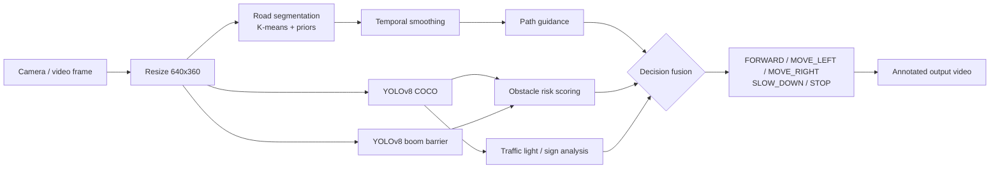

# 🚗 Vision-Based Driving Assistant

A real-time driving-assist pipeline that combines **classical digital image processing** with **YOLOv8 deep learning**. It reads a live camera feed or dash-cam video and decides what the car should do next: `FORWARD`, `MOVE_LEFT`, `MOVE_RIGHT`, `SLOW_DOWN` or `STOP`.

Built as a Digital Image Processing (DIP) course project.

<!-- Add a demo GIF here once you record one: -->
<!--  -->

---

## ✨ Features

| Module | Technique | What it does |
|---|---|---|
| **Road segmentation** | K-means on HSV + LAB + spatial features, adaptive road prior, connected components | Finds the drivable road area without a trained segmentation model |
| **Temporal smoothing** | EMA on road masks, majority vote over recent frames | Removes flicker between frames |
| **Obstacle detection** | YOLOv8n (COCO): people, bikes, cars, buses, trucks | Detects objects that could block the path |
| **Boom barrier detection** | Fine-tuned YOLOv8 model | Detects campus and parking boom barriers, which COCO doesn't cover |
| **Risk estimation** | Monocular cues: overlap with the car's safety zone, vertical position, box size | Scores each obstacle 0–1 and labels it NEAR / MEDIUM / FAR |
| **Traffic lights & signs** | HSV colour analysis, colour heuristics | Reads red / yellow / green lights, stop and school-zone signs |
| **Path guidance** | Near / mid / far look-ahead bands on the road mask | Steers toward the road centre and anticipates curves |
| **Decision fusion** | Priority rules (a STOP always wins) | Outputs one final driving action per frame |
| **Real-time performance** | Segmentation and detection run in parallel worker threads | Keeps the frame rate usable on a laptop |

## 🧠 Pipeline



## 📁 Project structure

```
├── main.py               # Runner: video/camera loop, threading, overlay drawing
├── segmentation.py       # Adaptive colour-based road segmentation (also runs standalone)
├── yolo_detection.py     # YOLO detectors, risk scoring, traffic light and sign checks
├── decision.py           # Path guidance and final action selection
├── models/
│   ├── yolov8n.pt            # COCO pretrained YOLOv8 nano
│   └── boom_barrier_best.pt  # Fine-tuned boom barrier detector
├── assets/images/car.png # Ego-car overlay (also defines the safety zone shape)
└── requirements.txt
```

## ⚙️ Setup

```bash
git clone https://github.com/MaheenKhalid11/DIP_Project.git
cd DIP_Project
python -m venv venv && source venv/bin/activate
pip install -r requirements.txt
```

## ▶️ Usage

Settings live at the top of `main.py`:

| Setting | Purpose |
|---|---|
| `USE_CAMERA_DEFAULT` | `True` to use a webcam, `False` to use a video file |
| `VIDEO_PATH` | Path to your input video |
| `OUTPUT_VIDEO_PATH` | Where the annotated video is saved (`None` to skip) |
| `SHOW_DISPLAY` | `False` for headless runs |

Then run:

```bash
python main.py
```

To run road segmentation alone on an image:

```bash
python segmentation.py road.jpg --show
```

## 🖼️ Output overlay

- **Green overlay:** detected drivable road
- **Car icon + outline:** ego vehicle and its safety zone
- **Coloured labels:** obstacles with proximity and risk score
- **Top banner:** final driving action for the frame

## 👥 Contributors

- [Maheen Khalid](https://github.com/MaheenKhalid11)
- [Muhammad](https://github.com/Muhammad-135)
- [Musfira Aslam](https://github.com/musfirakhan)
